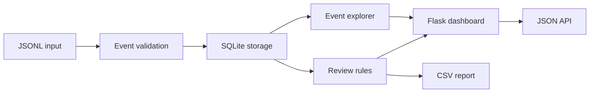

# Sentinel — Security Monitoring System

Sentinel is a local, educational security-event review application inspired by security information and event management (SIEM) systems. It imports structured event logs, stores them in SQLite, groups security-relevant records into explainable review signals, and presents them through a browser dashboard.


## Features

- Validated JSON Lines (JSONL) ingestion and normalized UTC timestamps.
- Persistent SQLite storage with duplicate-event prevention.
- Explainable security review rules for authentication failures, denied access, account lockouts and policy changes.
- Read-only responsive dashboard with severity labels, summary metrics, and event filters.
- JSON summary API and CSV alert export.
- A reproducible dataset containing 48 synthetic events.
- Automated tests and a GitHub Actions test workflow.

## Architecture



| Module | Responsibility |
| --- | --- |
| `events.py` | Validate and normalize incoming records |
| `storage.py` | Initialize and query the database; deduplicate by event ID |
| `rules.py` | Group event types by account and create review signals |
| `web.py` | Serve the dashboard, JSON endpoint and CSV export |
| `__main__.py` | Command-line interface for importing and serving data |

## Getting started

Install Python 3.11 or later. Open a terminal in the repository root.

### Windows PowerShell

```powershell
py -m venv .venv
.\.venv\Scripts\python.exe -m pip install -r requirements.txt
.\.venv\Scripts\python.exe -m sentinel demo
.\.venv\Scripts\python.exe -m sentinel serve
```

### Linux / macOS

```bash
python3 -m venv .venv
.venv/bin/python -m pip install -r requirements.txt
.venv/bin/python -m sentinel demo
.venv/bin/python -m sentinel serve
```

Open <http://127.0.0.1:5000> in a browser. Press Ctrl+C in the terminal to stop the server. The sample events use fictional accounts and documentation-only IP addresses. The demo is repeatable: importing it again does not duplicate records.

## Command-line usage

After activating the virtual environment (or substituting its Python executable):

```bash
python -m sentinel demo
python -m sentinel import data/demo.jsonl
python -m sentinel summary
python -m sentinel serve --port 5000
```

Use `--database path/to/file.db` before the subcommand to select a separate database. Default storage is `instance/sentinel.db`, excluded from Git.

### Event format

Each line is one JSON object, for example:

```json
{"event_id":"demo-001","timestamp":"2026-01-15T14:00:00Z","kind":"login_failure","account":"alex.demo","source":"192.0.2.10"}
```

Supported event types: `login_success`, `login_failure`, `access_denied`, `account_locked`, and `policy_change`. Import only synthetic data or data you have permission to process. Do not commit real account logs, secrets or database files.

### API

| Method | Endpoint | Description |
| --- | --- | --- |
| GET | `/` | Dashboard and event explorer |
| GET | `/api/summary` | JSON metrics, alerts and events |
| GET | `/api/summary?kind=login_failure` | Filter event records by type |
| GET | `/api/summary?q=alex.demo` | Search event records by account, source or ID |
| GET | `/reports/alerts.csv` | Download review signals for the entire dataset |

Filtering affects the event list, not global metrics or alerts. The event explorer returns at most 200 records; the matched count represents all matching events.

## Testing

```bash
python -m pip install -r requirements-dev.txt
python -m pytest -q
```

Tests cover validation, UTC conversion, rule aggregation, persistence, duplicate prevention, filtering, invalid input, demo data, and HTTP routes. The HTTP test is skipped when Flask is missing. The test workflow installs the development dependencies before running the suite.

## Design limitations

This is an educational, single-user batch analysis tool, not a production SIEM. It does not scan networks, connect to remote systems, collect live telemetry, authenticate dashboard users, or automatically block activity. Alerts are informational review signals, not proof of compromise. Rules aggregate the entire stored dataset, without time-window correlation. Storage and analysis are intended for small datasets and are not optimized for high-volume ingestion. The local Flask development server is not intended for public exposure. 

## Possible future improvements

- Add event timeline visualization and pagination.
- Add analyst review notes and incident status tracking.
- Add configurable retention and aggregate reporting.
- Benchmark processing performance on larger synthetic datasets.

## References

- [OWASP Logging Cheat Sheet](https://cheatsheetseries.owasp.org/cheatsheets/Logging_Cheat_Sheet.html)
- [Flask application setup](https://flask.palletsprojects.com/en/stable/tutorial/factory/)
- [Python sqlite3 documentation](https://docs.python.org/3/library/sqlite3.html)

## License

No open-source license has been selected for this starter project. Choose a license before publishing if you want to grant reuse permissions.
